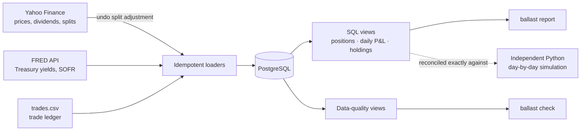
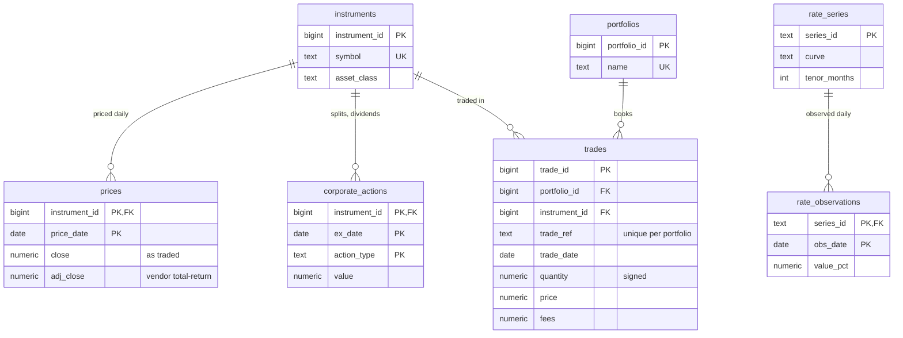

# Ballast

**A multi-asset portfolio risk platform built on PostgreSQL and Python.**

[](https://github.com/AkshayAmbulkar/ballast/actions/workflows/ci.yml)


Ballast holds a portfolio of equities, ETFs, Treasuries, options and a SOFR swap, and answers the questions a buy-side risk team asks every morning: *what do we own, what did we make, and what could we lose?* Every model runs on the same portfolio and the same database, so pricing, risk and performance numbers are consistent with each other.

> A ship's ballast keeps it steady in rough water. Risk management does the same for a portfolio.

## Roadmap

| Phase | Module | Status |
|---|---|---|
| 1 | **Data platform:** PostgreSQL schema, market-data pipeline, trade ledger, positions, daily P&L, data-quality checks | ✅ Done |
| 2 | **Fixed income:** bootstrapped Treasury zero curve, bond pricing, duration, convexity, DV01, key-rate DV01, curve scenarios, empirical ETF duration | ✅ Done |
| 3 | **Derivatives:** Black-Scholes and binomial pricing, Greeks, implied volatility smile, SOFR compounding, SOFR swap valuation and hedging | ✅ Done |
| 4 | **Risk:** historical, parametric and Monte Carlo VaR and Expected Shortfall, Kupiec and Christoffersen backtests, Basel traffic light, historical stress tests | ✅ Done |
| 5 | **Portfolio construction:** mean-variance, Black-Litterman, risk parity, Brinson attribution | Planned |
| 6 | **Product:** dashboard, API, PRD and deployment | Planned |

## What Phase 1 does



- **Market data pipeline.** Loads daily prices, dividends and splits for equities and ETFs from Yahoo Finance, and 11 Treasury constant-maturity yields plus SOFR from FRED. Every load is an upsert, so re-running it is safe.
- **Trade ledger as the source of truth.** Positions are never stored; they are derived from trades, so any historical position can be rebuilt and audited.
- **Daily P&L in SQL.** Window functions and lateral joins compute split-adjusted positions, market value, and daily P&L including dividends and fees.
- **Data-quality checks.** SQL views flag trades booked on non-trading days, trade prices far from the close, and price jumps that no recorded split explains.

## What Phase 2 does

- **Treasury zero curve every day.** The 11 CMT par yields are bootstrapped into discount factors (bills under 6 months as simple bond-equivalent yields, then a semiannual par bootstrap to 30 years) and stored in the `zero_curves` table, about 1,200 daily curves since 2022.
- **Bonds inside the portfolio.** Treasury notes and bonds are marked daily off the curve, with Actual/Actual accrued interest and coupons credited as income, so they flow through the same positions and P&L views as equities.
- **Interest-rate risk.** Yield to maturity, modified and effective duration, convexity, DV01, and key-rate DV01 at all 11 tenors, which add up exactly to the parallel DV01.
- **Scenarios with full revaluation.** Parallel ±100bp, steepeners and flatteners, and the actual 2022 curve moves applied to today's curve, each shown next to its first-order key-rate estimate.
- **Market-implied duration.** A regression of TLT's daily returns on 20-year yield changes estimates its empirical duration and how much of its return the change in rates explains.
- **Checked against textbook figures.** Hull's bootstrap and duration examples are reproduced to the published decimals.

Conventions, formulas and limitations: [docs/methodology/02-fixed-income.md](docs/methodology/02-fixed-income.md).

## What Phase 3 does

- **Option pricing.** Black-Scholes-Merton with dividends, and binomial trees for American options, with Hull's control variate so tree noise does not distort the Greeks. Hull's Black-Scholes, Greeks and American-put examples are reproduced to the published decimals, including the tree's convergence path (4.263, 4.272, 4.278, 4.283).
- **Options inside the portfolio.** A protective SPY put and a covered NVDA call are marked daily (realized volatility, Treasury zero rate, trailing dividend yield) and flow through the same P&L views as stocks and bonds.
- **Greeks and delta-adjusted exposure.** Position delta, gamma, vega, theta and rho, with option deltas netted against stock holdings per underlying.
- **Implied volatility smile from live option chains.** The forward is implied from put-call parity and each out-of-the-money option is inverted with Black-76; results are compared with Yahoo's own implied volatilities and saved for SQL analysis.
- **SOFR compounding checked against the New York Fed.** Reproduces the Fed's published SOFR Index worked example to 8 decimals, and matches all 1,178 of the Fed's published 30-day SOFR averages from February 2022 to October 2026 exactly at 5 decimals (`ballast sofr-check`).
- **SOFR swap as a hedge.** A pay-fixed 10-year SOFR swap, valued with realized fixings plus a projected curve, offsets most of the bonds' DV01; the combined key-rate table shows the curve risk a single swap leaves behind.

Conventions, formulas and limitations: [docs/methodology/03-derivatives.md](docs/methodology/03-derivatives.md).

## What Phase 4 does

- **VaR three ways, with full revaluation.** Historical simulation (500 days), parametric (EWMA covariance) and Monte Carlo (10,000 scenarios), each with Expected Shortfall. Every scenario reprices stocks, bonds, the swap and the options, using a vectorized curve bootstrap and option price grids.
- **Diversification.** Each asset class's VaR on its own, and the benefit of holding them together.
- **Daily backtest.** VaR set at each previous close against the P&L actually booked the next day since January 2024, with the Kupiec, Christoffersen and conditional-coverage tests and the Basel traffic light.
- **Historical stress tests.** The 2022 rate shock, the SVB failure, the August 2024 yen carry unwind, the DeepSeek day and the April 2025 tariff selloff, replayed on today's portfolio.

Definitions, tests and limitations: [docs/methodology/04-risk.md](docs/methodology/04-risk.md).

## Design decisions

**Prices are stored as traded, not back-adjusted.** Yahoo back-adjusts history for every later split. Ballast reverses that adjustment before storing, and applies splits explicitly from a `corporate_actions` table. This keeps trade prices and market prices in the same units, which is how production position-keeping systems work. With split-adjusted prices, a position held through NVIDIA's June 2024 10-for-1 split would be misvalued by a factor of 10.

**Exact arithmetic for money and share counts.** Prices, quantities and P&L are PostgreSQL `NUMERIC`, never floating point. Cumulative split ratios use a custom exact aggregate (`numeric_product`) instead of `exp(sum(ln(x)))`.

**Two independent P&L implementations.** The SQL views are set-based. A separate Python module walks forward one day at a time like a back-office position keeper. Tests require the two to agree exactly, on a hand-worked example and on the full seed portfolio.

**Versioned schema.** Migrations are numbered SQL files applied in order and recorded with a SHA-256 checksum. Editing a migration after it has been applied is detected and refused.

Full definitions, a worked example and known limitations are in [docs/methodology/01-positions-and-pnl.md](docs/methodology/01-positions-and-pnl.md).

## Data model



Views built on these tables: `positions_daily`, `position_pnl_daily`, `portfolio_pnl_daily`, `holdings_latest`, `treasury_cmt_curve`, and the three `dq_*` checks.

## Quickstart

You need Python 3.10 or later, [Docker Desktop](https://www.docker.com/products/docker-desktop/), and a free [FRED API key](https://fred.stlouisfed.org/docs/api/api_key.html).

```bash
# 1. Install into a virtual environment
python -m venv .venv
source .venv/bin/activate          # Windows: .venv\Scripts\activate
pip install -e ".[dev]"

# 2. Store your FRED key OUTSIDE the project folder (see Security and privacy)
mkdir -p ~/.config/ballast
cp secrets.env.example ~/.config/ballast/secrets.env
chmod 600 ~/.config/ballast/secrets.env
open -e ~/.config/ballast/secrets.env   # paste your key after FRED_API_KEY=, save

# 3. Start PostgreSQL (reachable from this computer only)
docker compose up -d

# 4. Build everything: schema, market data, curves, model marks, trades, checks, report, risk
ballast bootstrap
```

If `~/.config` is not writable on your machine, keep `secrets.env` in any private folder and point Ballast at it, for example `echo 'export BALLAST_CONFIG_DIR="$HOME/.ballast"' >> ~/.zshrc`.

### Commands

| Command | What it does |
|---|---|
| `ballast migrate` | Apply pending database migrations |
| `ballast seed-instruments` | Load `data/seed/instruments.csv` |
| `ballast load-prices` | Load prices, dividends and splits from Yahoo Finance |
| `ballast load-rates` | Load Treasury yields and SOFR from FRED |
| `ballast build-curves` | Bootstrap and store the Treasury zero curve for every date |
| `ballast price-bonds` | Mark Treasury holdings off the curve and record coupons |
| `ballast price-options` | Mark option positions (Black-Scholes, or a binomial tree for American options) |
| `ballast price-swaps` | Set at-market swap rates, mark swaps, record swap payments |
| `ballast seed-trades` | Load `data/seed/trades.csv`, or `--file` for another ledger (a blank price means "at that day's close") |
| `ballast check` | Run data-quality checks; exit code 1 if any fail |
| `ballast report` | Print current holdings, weights and lifetime P&L |
| `ballast curve [--date]` | Show the Treasury curve: par, zero and forward rates, discount factors |
| `ballast rates-risk` | Duration, DV01, key-rate DV01 and scenario P&L for bonds and swaps together |
| `ballast greeks` | Option Greeks and delta-adjusted equity exposure |
| `ballast vol-smile [--symbol SPY --expiry DATE]` | Implied volatility smile from Yahoo's listed option chain (run during U.S. market hours) |
| `ballast sofr-check` | Compare Ballast's SOFR compounding with the NY Fed's published 30-day averages |
| `ballast var [--confidence 0.99 --lookback 500 --sims 10000]` | 1-day VaR and Expected Shortfall by three methods, plus VaR by asset class |
| `ballast backtest [--confidence 0.99]` | Daily VaR backtest with Kupiec, Christoffersen and Basel traffic-light results |
| `ballast stress` | Replay historical market episodes on today's portfolio |
| `ballast rate-sensitivity [--symbol TLT --series DGS20 --since DATE]` | Empirical duration of an ETF against a Treasury yield |
| `ballast bootstrap` | Run all of the above in order |

## Tests

```bash
pytest
```

The suite runs against a real PostgreSQL database (`ballast_test`, created automatically) and makes no network calls; market data is replaced with fixtures and synthetic series. It covers:

- a hand-worked P&L example with a split, a dividend, fees and a partial sale
- the accounting identity *lifetime P&L = final market value − net trade cash + dividends*
- exact agreement between the SQL views and the independent Python simulation
- conversion of Yahoo's split-adjusted history back to as-traded prices
- schema constraints, migration checksums, idempotent loads and data-quality checks
- an end-to-end `ballast bootstrap` on the seed portfolio
- Hull's bootstrap and duration examples, par bonds repricing to 100, key-rate DV01s summing to parallel DV01, and coupons flowing through P&L without artificial jumps
- Hull's Black-Scholes, Greeks and binomial-tree examples, the NY Fed's SOFR Index worked example, swap valuation identities, a negative swap payment flowing through P&L, and recovery of a known volatility skew from a synthetic option chain
- VaR and ES definitions, normal constants (2.326σ, 2.665σ), Monte Carlo against the closed form, the RiskMetrics EWMA recursion, Kupiec against an independent binomial likelihood ratio, clustered exceptions caught by Christoffersen, and historical VaR from the database equal to a hand calculation
- the security guarantees below: no key in error messages, secrets outside the repository, localhost-only database, a test suite that refuses to touch any database not named `*_test`

CI runs the suite on Python 3.10 and 3.12 against PostgreSQL 16 on every push.

## Security and privacy

Ballast is designed so that nothing personal or secret can leave your computer by accident. Each point below is enforced by a test in [`tests/test_security.py`](tests/test_security.py), so CI fails if a change breaks it.

- **Secrets never live in the project folder.** The FRED key is read from `~/.config/ballast/secrets.env`, outside the repository, so it cannot be committed, drag-and-dropped into a GitHub upload, or zipped with the code. Ballast ignores any `.env` inside the project and warns if one exists, or if the secrets file is readable by other users.
- **Keys never appear in error messages.** HTTP libraries put the full request URL, API key included, into their errors. Ballast replaces those with clean messages and suppresses the original, so a screenshot of an error is safe to share.
- **The database is reachable from this computer only.** Docker publishes PostgreSQL on `127.0.0.1`, not on your network, and mounts no folders from your computer.
- **Your own trades stay private.** Put real trades in `data/private/` (git-ignored) and load them with `ballast seed-trades --file data/private/trades.csv`. Never put them in `data/seed/`, which is public.
- **Tests cannot wipe real data.** The test suite rebuilds its database from scratch, so it refuses to run unless the database name ends in `_test`.

What does leave your computer: requests to Yahoo Finance (the ticker symbols you load) and to FRED (your API key and the series IDs). See [SECURITY.md](SECURITY.md) for details.

## Project structure

```
ballast/
├── db/migrations/          numbered SQL migrations (schema, views, checks)
├── data/seed/              instrument master and trade ledger (CSV)
├── docs/methodology/       definitions, worked examples, limitations
├── src/ballast/
│   ├── cli.py              `ballast` command-line interface
│   ├── db.py               engine and migration runner
│   ├── derivatives/        options, Greeks, implied volatility, SOFR compounding, swaps
│   ├── fixed_income/       curve bootstrap, bond pricing, rate risk, scenarios
│   ├── market_data/        FRED and Yahoo clients, upsert loaders
│   ├── portfolio/          trade seeding, reference P&L simulation
│   └── risk/               VaR, Expected Shortfall, backtests, stress tests
└── tests/
```

## Data sources

- **FRED**, Federal Reserve Bank of St. Louis: Treasury constant-maturity yields (`DGS1MO` to `DGS30`) and `SOFR`. Requires a free API key.
- **Yahoo Finance**, via the unofficial [`yfinance`](https://github.com/ranaroussi/yfinance) library: equity and ETF prices and corporate actions. Intended for research and education; not institutional-quality data.

## License

MIT. See [LICENSE](LICENSE).
