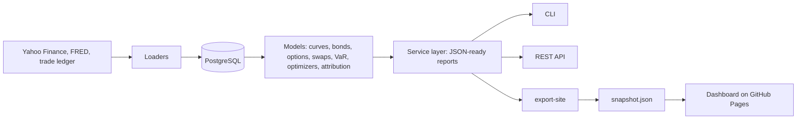

# Ballast: product requirements

| | |
|---|---|
| **Product** | Ballast, a multi-asset portfolio risk platform |
| **Owner** | Akshay Ambulkar |
| **Status** | v1 shipped (phases 1 to 6); this document is kept current with the code |
| **Live dashboard** | https://akshayambulkar.github.io/ballast/ |

## 1. Summary

Small investment teams run portfolios that mix stocks, Treasuries, listed options and interest-rate swaps, but measure risk in spreadsheets. Ballast gives them one consistent system: positions and P&L rebuilt from the trade ledger, every instrument priced off the same market data, one-day risk with backtests that show whether the risk numbers can be trusted, portfolio construction tools, and performance attribution. It is delivered as a command-line tool, a read-only REST API and a published dashboard.

## 2. Problem

A buy-side risk team has to answer three questions every morning: what do we own, what did we make, and what could we lose? For a small team, each answer usually lives in a different spreadsheet:

- **Inconsistent numbers.** The P&L sheet, the bond sheet and the options sheet use different prices, curves and dates, so their totals do not reconcile.
- **Nothing is reproducible.** Formulas are edited in place, there is no history, and a number from last month cannot be recomputed.
- **Models are never checked.** VaR is reported without a backtest; nobody knows whether "99%" actually means 99%.
- **Rates and derivatives are approximated.** Bonds get one duration number, options get delta at best, and a swap hedge is a separate calculation.

Enterprise risk systems solve this but are priced and staffed for large institutions. The gap is a transparent, testable system a two- or three-person team can run and audit themselves.

## 3. Users

| User | What they need from Ballast | Where they use it |
|---|---|---|
| **Portfolio manager** | Today's value and P&L, the biggest risks, how the book would have done in past crises, and what a change of view implies for the allocation | Dashboard: Overview, Risk, Construction |
| **Risk analyst** | Daily VaR and Expected Shortfall by three methods, a backtest that a risk committee will accept, stress tests and rate risk by tenor | CLI and API; Risk, Rates and Model checks |
| **Operations / data** | Correct prices, splits, dividends and trades, with exceptions flagged before anyone reads a report | `ballast check`, data-quality views |
| **Investment committee, clients** | A read-only view of results and of how they are validated | Published dashboard |
| **Engineers integrating Ballast** | Stable, documented, typed endpoints | REST API and its OpenAPI reference |

## 4. Jobs to be done

1. *When markets close,* I want positions, prices and P&L to update with one command, *so that* the morning report never depends on manual steps.
2. *When I report VaR,* I want to show how often it has been exceeded and whether that is statistically acceptable, *so that* the committee can trust the number.
3. *When rates move,* I want to know which part of the curve hurts us and whether the swap still hedges the bonds, *so that* I can adjust the hedge at the right tenor.
4. *When I have a market view,* I want to see how the optimal allocation changes, *so that* I can size the trade against the risk it adds.
5. *At the end of a period,* I want to explain return against the benchmark by decision (allocation or selection), *so that* the team learns which decisions added value.
6. *When someone questions a number,* I want to trace it to its inputs and to a published reference, *so that* the model's credibility does not rest on trust.

## 5. Goals and non-goals

**Goals for v1**

- One database and one set of market data behind every number, so pricing, risk and performance reconcile.
- Every model validated against an independent, published reference, with the check automated in CI.
- Reproducible results: versioned schema, seeded simulations, no hidden manual steps.
- A shareable, read-only view of results that never exposes private data or credentials.

**Non-goals for v1**

- Order management, execution or trade capture (trades arrive as a ledger file).
- Real-time or intraday risk; Ballast works on daily closes.
- Regulatory capital (FRTB, SA-CCR), credit risk and counterparty exposure.
- Multiple currencies; everything is in US dollars.
- Multi-user accounts and permissions on a hosted server.

## 6. Success metrics

| Metric | Target | How it is measured | v1 result |
|---|---|---|---|
| Model validation coverage | Every model has an independent reference check | Test suite, run on every commit | Met: Hull (bonds, options, trees), He and Litterman (Black-Litterman), New York Fed (SOFR), closed forms (optimizers, VaR) |
| Reference accuracy | Published figures reproduced to their published precision | Tests | Met; SOFR averages match the New York Fed's at 5 decimals |
| VaR reliability | Backtest not rejected at 5% (Kupiec); Basel green zone | `ballast backtest`, dashboard | Reported live on the dashboard |
| Reconciliation | SQL P&L equals an independent simulation exactly | `test_sql_matches_independent_simulation` | Met |
| Time to first report | One command from an empty database to a full report | `ballast bootstrap` | Met |
| Privacy | No secret or private trade can be published by accident | Security tests; export guard | Met |

## 7. Requirements

Priorities use MoSCoW (Must, Should, Could, Won't for v1). Each requirement's acceptance criterion is an automated test, so the status column cannot drift from the code.

| ID | Requirement | Priority | Acceptance criterion | Status |
|---|---|---|---|---|
| D1 | Load prices, dividends and splits; store prices as traded | Must | Split-adjusted vendor history converted back to traded prices | ✅ |
| D2 | Derive positions and daily P&L from the trade ledger in SQL | Must | SQL equals an independent day-by-day simulation; accounting identity holds | ✅ |
| D3 | Flag bad data before reporting | Must | Off-calendar trades, price outliers and unexplained jumps are caught | ✅ |
| F1 | Bootstrap a daily Treasury zero curve from par yields | Must | Reproduces Hull's bootstrap example; par bonds reprice to 100 | ✅ |
| F2 | Price Treasuries with duration, convexity, DV01 and key-rate DV01 | Must | Key-rate DV01s sum to the parallel DV01; Hull's duration example | ✅ |
| F3 | Curve scenarios with full revaluation | Should | Full revaluation close to the duration-convexity estimate | ✅ |
| X1 | Price European and American options with Greeks | Must | Hull's Black-Scholes, Greeks and tree examples | ✅ |
| X2 | SOFR compounding and swap valuation | Must | New York Fed SOFR Index worked example; swap at par worth zero | ✅ |
| X3 | Implied volatility smile from listed chains | Could | Recovers a known skew from a synthetic chain | ✅ |
| R1 | One-day VaR and ES by historical, parametric and Monte Carlo methods | Must | Normal constants; Monte Carlo equals the closed form for a linear book | ✅ |
| R2 | Daily VaR backtest with statistical tests | Must | Kupiec against the binomial likelihood ratio; Christoffersen catches clustering | ✅ |
| R3 | Historical stress tests | Should | 2022 bond P&L consistent with the fixed-income scenario | ✅ |
| C1 | Mean-variance optimizers and risk parity with position caps | Must | Closed-form minimum variance and tangency; equal risk contributions | ✅ |
| C2 | Black-Litterman with absolute and relative views | Must | He and Litterman's published example | ✅ |
| C3 | Brinson-Fachler attribution linked over time | Must | Effects add up exactly to the cumulative active return | ✅ |
| P1 | Read-only REST API with a typed, documented schema | Should | Every endpoint answers with its schema; bad input gets 404/409/422, never a stack trace | ✅ |
| P2 | Published dashboard, no server or credentials | Should | Loads nothing from other websites; browser optimizer matches Python | ✅ |
| P3 | Users can try their own views in the dashboard | Could | Same results as the Python engine to 10⁻⁶ | ✅ |
| P4 | Hosted multi-user API with authentication | Won't (v1) | | |

## 8. User experience

**Dashboard.** The first screen states the portfolio's value, its one-in-a-hundred bad day and how often that estimate has been exceeded, above the chart that proves it (daily P&L against the VaR line). Tabs then follow the jobs in section 4: Overview, Rates, Options and swap, Risk, Construction (with the views panel), Attribution, Model checks and API. Every chart has a table view, a keyboard-accessible tooltip, and light and dark modes; the layout works from phone width up.

**API.** Read-only `GET` endpoints, one per report, returning JSON with documented units (`/api/docs` when running locally; the same reference is on the dashboard's API tab). Parameters are bounded so a single request cannot exhaust the machine.

**CLI.** One verb per report (`ballast var`, `ballast optimize --view NVDA-SPY:0.05`), and `ballast bootstrap` to run everything.

## 9. Architecture

The service layer is the only path from the models to the outside world, so the CLI, the API and the dashboard always show the same numbers.

## 10. Risks and mitigations

| Risk | Likelihood | Impact | Mitigation |
|---|---|---|---|
| Free market data changes or breaks (yfinance is unofficial) | Medium | High | Idempotent loaders, data-quality checks, explicit split handling; the loader is isolated so a paid vendor can replace it |
| Model error goes unnoticed | Medium | High | Reference tests for every model, daily VaR backtest, attribution identity check, shown on the dashboard |
| Private trades or keys published by accident | Low | High | Secrets outside the project folder; export refuses non-sample portfolios and scans its output; API answers only on this computer |
| Treasury curve used as a SOFR proxy misprices swaps | Medium | Medium | Documented limitation; a SOFR OIS curve is first on the roadmap |
| Sample covariance unstable for larger universes | Medium | Medium | Documented; shrinkage estimator on the roadmap |

## 11. Roadmap after v1

Scored with RICE (reach in users per quarter, impact 0.25 to 3, confidence %, effort in person-weeks). The scores are estimates to rank the work, not measurements.

| Item | Reach | Impact | Confidence | Effort | RICE |
|---|---|---|---|---|---|
| SOFR OIS curve bootstrapped from SOFR futures and swaps | 4 | 2 | 80% | 3 | 2.1 |
| Ledoit-Wolf shrinkage covariance | 4 | 1 | 90% | 1 | 3.6 |
| Scheduled daily refresh of the published snapshot | 5 | 1 | 80% | 1 | 4.0 |
| Factor risk model (market, rates, size, value) | 4 | 2 | 60% | 4 | 1.2 |
| Multi-currency positions with FX risk | 2 | 2 | 70% | 5 | 0.6 |
| Hosted API with authentication | 3 | 1 | 50% | 4 | 0.4 |

Next up, in RICE order: scheduled refresh, shrinkage covariance, then the SOFR curve.

## 12. Release history

| Release | Scope |
|---|---|
| Phase 1 | Data platform: schema, market data, trade ledger, positions, P&L, data quality |
| Phase 2 | Fixed income: Treasury curve, bond pricing and risk, scenarios |
| Phase 3 | Derivatives: options, Greeks, volatility smile, SOFR, swaps |
| Phase 4 | Risk: VaR and ES, backtesting, stress tests |
| Phase 5 | Portfolio construction and performance attribution |
| Phase 6 | Product: service layer, REST API, published dashboard, this document |

## 13. Open questions

- Should the published snapshot refresh on a schedule, and if so, where do the market-data credentials live? (Today it is refreshed by hand, so no credentials are ever stored online.)
- Which benchmark should be the default for a portfolio with options and a swap: the current 60/40, or one that includes a rates hedge?
- Is a one-day horizon enough, or should VaR also be reported at ten days for committee reporting?
